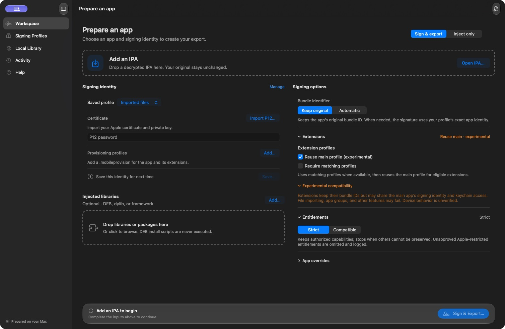
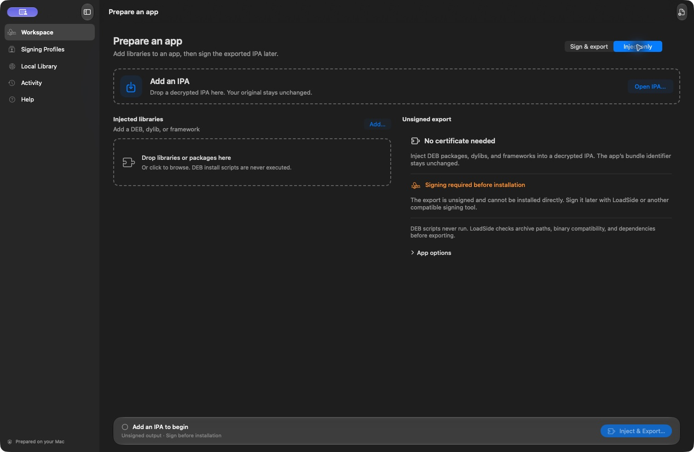

# LoadSide

**Sign iOS apps. Keep the workflow on your Mac.**

A native macOS app and CLI for signing decrypted IPAs with your own certificate and provisioning profiles.

[Get started](docs/GETTING_STARTED.md) · [Documentation](docs/README.md) · [Releases](https://github.com/Mxlted/LoadSide/releases) · [Report a bug](https://github.com/Mxlted/LoadSide/issues)

## Your signing workspace

Bring an IPA and your signing files, review the signing plan, and export. LoadSide checks the app, profiles, entitlements, and nested code, then verifies local signatures before publishing the output. Your original files stay untouched.

- **Native, focused workflow.** Drag in files, inspect extensions, follow real progress, and review actionable diagnostics in Activity.
- **Reusable signing profiles.** Keep private local copies of signing files, with optional password storage in macOS Keychain. Signing keys use a temporary, isolated keychain.
- **Injection when you need it.** Add supported DEBs, dylibs, and frameworks while signing, or use **Inject only** to prepare an unsigned IPA without signing credentials.
- **A library on your Mac.** Keep verified exports together and explicitly share downloads or eligible OTA install links through local HTTP, your HTTPS server, or automatic HTTPS.
- **Automation included.** The bundled CLI runs the same engine, supports structured output, and keeps passwords out of command-line arguments.

See the unsigned injection workflow

## Get LoadSide

**[Download LoadSide 0.1.0-rc.3](https://github.com/Mxlted/LoadSide/releases/tag/v0.1.0-rc.3)** for **Apple Silicon and macOS 14+**.

Open the **DMG**, drag **LoadSide** to **Applications**, then launch it from there. A ZIP is also available, and both include the CLI. Automatic HTTPS requires macOS 15+.

This is an **experimental prerelease**, ad-hoc signed and not notarized. macOS may ask for [per-app approval](docs/INSTALLATION.md#first-launch). Device compatibility and full macOS 14 qualification remain incomplete. See [installation](docs/INSTALLATION.md) for checksums and source builds, and [verification status](docs/STATUS.md) for test coverage.

## Your first export

1. Add a decrypted `.ipa` in **Workspace** and choose **Sign & export**.
2. Select a saved signing profile, or add your `.p12`, password, and `.mobileprovision` files.
3. Review the signing plan and any identifier, extension, or entitlement diagnostics. Add compatible injections if needed.
4. Choose a new output path and select **Sign & Export**. Review the result in **Activity** or **Local Library**.

The [getting-started guide](docs/GETTING_STARTED.md) explains the policies and the unsigned injection workflow. The app also includes built-in Help.

## Know the boundaries

LoadSide works with decrypted apps you are authorized to modify. It does not decrypt App Store apps, create Apple credentials, bypass device provisioning, or make arbitrary jailbreak tweaks compatible with stock iOS.

**Keep original** preserves metadata bundle IDs by default; the default experimental extension policy may reuse the main profile's signing identity. Both can produce identity mismatches with unverified device behavior. Matching profiles are preferred, and Strict entitlements remains the default. A verified local signature is not proof that an app installs or works on a device. Read [compatibility](docs/COMPATIBILITY.md) before choosing a policy.

Signing stays local. Sharing starts only when requested; automatic HTTPS routes library traffic through Cloudflare, and anyone with the private sharing link can download it. See [sharing](docs/SHARING.md) and [security](SECURITY.md).

## Contribute

Start with [Contributing](CONTRIBUTING.md) for the development workflow, tests, and source map. [Architecture](docs/ARCHITECTURE.md) covers the shared engine and its safety boundaries.

[MIT licensed](LICENSE). Built with SwiftUI, Foundation, Security, and the system libarchive. The optional HTTPS helper is cloudflared; see [third-party notices](THIRD_PARTY_NOTICES.md) for licenses and acknowledgments.
